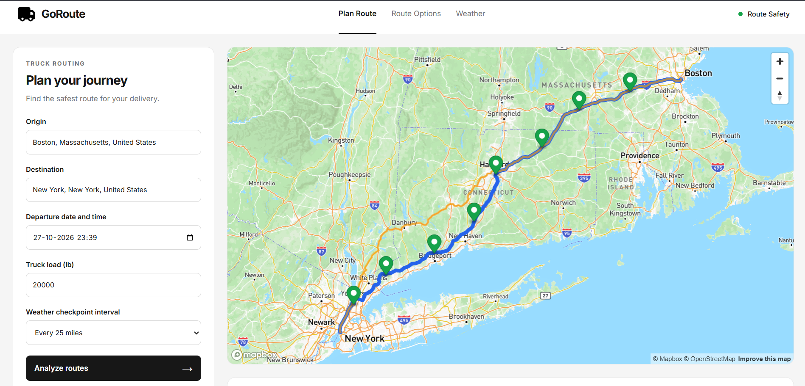

# 🚛 GoRoute — Weather-Aware Truck Routing

**Plan smarter journeys with weather-aware route analysis.**

GoRoute is a truck route planning application that helps users compare alternative routes by analyzing weather conditions, checkpoint-level risks, cargo weight, and estimated journey duration.

Built with React and Django REST Framework, GoRoute combines interactive mapping, weather information, and risk-based route ranking to help users make more informed transportation decisions.

---

## 📸 Application Preview



---

## ✨ Features

### 🗺️ Alternative Route Planning
- Enter origin and destination locations.
- Retrieve alternative routes using Mapbox.
- Compare routes through an interactive map and route cards.
- Select a route to highlight it on the map.

### 🌦️ Weather-Aware Analysis
- Retrieve weather information for checkpoints along a route.
- View wind speed, precipitation, rain, and snowfall.
- Select checkpoints on the map to inspect weather details.
- Configure the distance between weather checkpoints.

### ⚠️ Weather Risk Classification
Classify checkpoint weather conditions into five categories:

| Risk Level | Description |
|---|---|
| 🟢 Low | Lower assessed weather risk |
| 🟡 Moderate | Moderate assessed weather risk |
| 🟠 High | Elevated assessed weather risk |
| 🔴 Severe | Significant assessed weather risk |
| ⛔ No Travel | Conditions exceed configured risk thresholds |

### 🚚 Load-Aware Risk Assessment
- Consider truck cargo weight when evaluating certain wind conditions.
- Apply additional risk rules for heavier loads.
- Evaluate the highest risk identified across wind, rain, and snowfall.

### 📊 Route Ranking and Recommendations
Compare routes using:
- Distance associated with severe-risk checkpoints.
- Distance associated with high-risk checkpoints.
- Average checkpoint risk score.
- Estimated journey duration.

The backend ranks routes using these metrics and identifies a recommended route according to the configured ranking criteria.

### 📍 Location Autocomplete
- Search for origin and destination locations.
- Receive location suggestions while typing.
- Select a suggested location from the dropdown.

### 💻 User Interface
- Interactive route map.
- Clickable route comparison cards.
- Checkpoint weather popups.
- Smooth navigation between route planning and route comparison.
- Loading indicators during route analysis.

---

## 🛠️ Technology Stack

### Frontend
- React
- Vite
- JavaScript
- CSS

### Backend
- Python
- Django
- Django REST Framework

### External Services
- **Mapbox** — Mapping, geocoding, and route information.
- **Open-Meteo** — Weather data.

---

## 📁 Project Structure

```text
GoRoute/
├── backend/
│   ├── manage.py
│   ├── requirements.txt
│   └── ...
│
├── frontend/
│   ├── public/
│   ├── src/
│   │   ├── components/
│   │   ├── pages/
│   │   ├── services/
│   │   ├── App.jsx
│   │   └── ...
│   ├── package.json
│   ├── package-lock.json
│   ├── vite.config.js
│   └── ...
│
├── screenshots/
│   └── dashboard.png
│
├── .gitignore
└── README.md
```

*The directory structure above is illustrative. Adjust it if your actual repository differs.*

---

## ⚙️ Prerequisites

Before running GoRoute locally, install:

- Python
- Node.js and npm
- Git
- A Mapbox access token

---

## 🚀 Getting Started

### 1. Clone the Repository

```bash
git clone https://github.com/vinay-sajith/weather-truck-routing
cd GoRoute
```


### 2. Set Up the Backend

Navigate to the backend directory:

```bash
cd backend
```

Create a Python virtual environment:

```bash
python -m venv venv
```

Activate it on Windows:

```bash
venv\Scripts\activate
```

Install the backend dependencies:

```bash
pip install -r requirements.txt
```

Configure any required environment variables and database settings.

Run database migrations:

```bash
python manage.py migrate
```

Start the Django development server:

```bash
python manage.py runserver
```

The backend will normally be available at:

```text
http://127.0.0.1:8000/
```

Keep this terminal running.

### 3. Set Up the Frontend

Open a second terminal and navigate to the frontend directory:

```bash
cd frontend
```

Install the JavaScript dependencies:

```bash
npm install
```

Create a `.env` file inside the frontend directory and configure your Mapbox token:

```env
VITE_MAPBOX_ACCESS_TOKEN=your_mapbox_access_token
```

Use the exact environment variable name expected by your application.

Start the frontend:

```bash
npm run dev
```

Open the local URL displayed in your terminal, usually:

```text
http://localhost:5173/
```

Keep both the frontend and backend servers running while using the application.

---

## 🧠 How Route Ranking Works

GoRoute evaluates route alternatives using checkpoint-level weather risk information.

The current ranking logic prioritizes:

1. Routes with less distance associated with **Severe** risk.
2. Routes with less distance associated with **High** risk.
3. Routes with a lower average checkpoint risk score.
4. Routes with a shorter estimated journey duration.

The application uses these criteria to rank routes and identify a recommended option.

---

## 🌧️ Weather Risk Assessment

The backend evaluates wind, rain, and snowfall using configurable thresholds.

The highest risk category identified among these weather factors determines the checkpoint's combined weather risk, subject to the configured cargo-weight rules.

The current implementation uses:
- Wind speed in miles per hour.
- Precipitation and rain in inches.
- Snowfall in centimetres.

These categories represent application-defined assessments and are not certified road-safety classifications.

---

## 🔐 Environment Variables and Security

Keep sensitive configuration out of version control.

- Do not commit `.env` files containing secrets.
- Configure Django's `SECRET_KEY` through environment variables in production.
- Set `DEBUG=False` for production deployments.
- Configure Django's `ALLOWED_HOSTS`.
- Configure CORS to allow your deployed frontend's origin.
- Restrict the Mapbox public access token to the appropriate URLs and permissions.
- Configure production API URLs through environment variables as needed.

---

## ☁️ Deployment

GoRoute can be deployed using separate frontend and backend hosting services.

A possible deployment setup is:

| Component | Suggested Platform |
|---|---|
| React frontend | Vercel |
| Django backend | Render |

Deployment requires production environment variables, correct CORS settings, a publicly accessible backend API, and appropriate database configuration.

Deployment instructions and public application URLs can be added here once hosting is complete.


---

## ⚠️ Disclaimer

GoRoute is a route-planning and weather-analysis project intended to support transportation decisions.

Its risk classifications are based on configurable application logic and available weather data. They do not guarantee road safety or replace official weather warnings, road restrictions, professional judgment, or applicable transportation regulations.

---

## 👨‍💻 Author

**Vinay Sajith**

- GitHub: [Github profile](https://github.com/vinay-sajith)
- LinkedIn: [Vinay Sajith](https://www.linkedin.com/in/vinay-sajith)
- Portfolio: [vinay-sajith.github.io/vinay-portfolio](https://vinay-sajith.github.io/vinay-portfolio)

---

*Built as a project exploring weather-aware routing, REST APIs, and risk-based route analysis.*